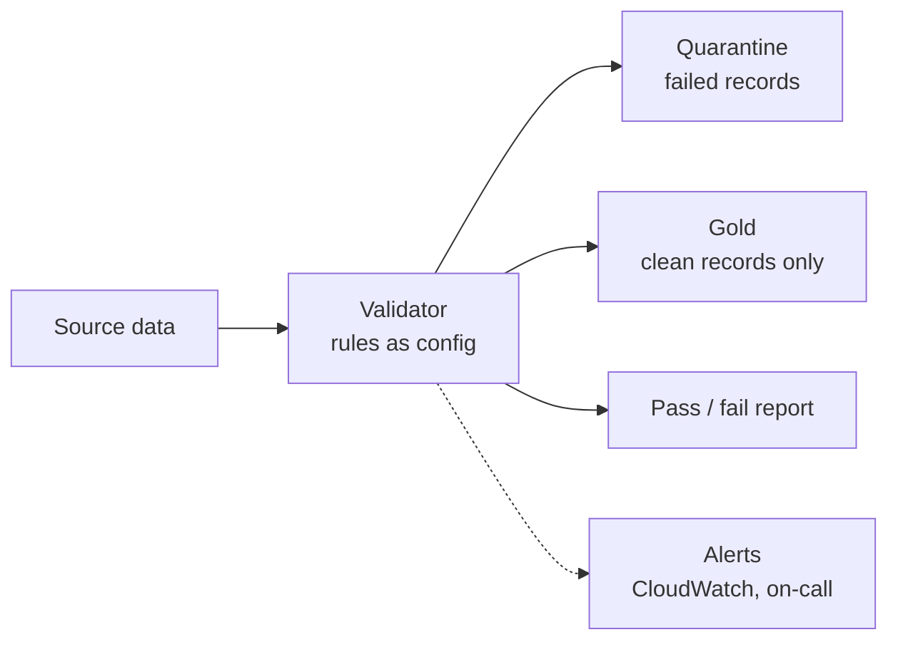

# Data Quality Validation Framework

Portfolio implementation based on production work experience. All data is synthetic, all code is original and clean-room, and no proprietary code, data, schema names, or internal system details from any employer are included.

## The problem

Bad data that lands unnoticed poisons every dashboard and model downstream. Checks need to run before data lands in gold, not after someone spots a wrong number.

## What it does

A small, rule-driven framework: rules are config, not code. A validator loads a dataset, runs every rule, quarantines the records that fail, and writes a pass/fail report. Freshness is checked against the latest timestamp, the same way a daily noon DQ check watches for no new data.

Rules included: schema check (required columns, types), not-null, uniqueness, range checks, referential checks, and freshness.

## Architecture — Before / After

### Before

Bad data landed unnoticed. Checks were manual, run after the load, with no quarantine, no alert, and no record of what failed. A bad load could sit in gold until a business user found it.

### After

Data is validated on arrival. Records that fail are quarantined, the failure is logged and alerted, and only clean records move on to gold.



<details>
<summary><b>Validation rule flow — click to expand</b></summary>

<br>

1. **Load:** read the dataset and the rule config for that table.
2. **Schema check:** required columns present, types match, otherwise fail the whole batch.
3. **Row rules:** not-null, uniqueness, and range checks, row by row, collecting every failure with its record id and rule name.
4. **Freshness check:** read the latest timestamp in the batch and compare it with the expected arrival time; if no new data, fail freshness and alert.
5. **Quarantine:** failed records are written to quarantine, never to gold, with the reason attached.
6. **Report:** write a pass/fail report per rule, with counts and the quarantined record ids.

</details>

| Earlier issues | Risk | Impact after |
|---|---|---|
| Bad data landed unnoticed, checks were manual and after the load | Wrong numbers reached dashboards and models before anyone noticed | Bad data is caught on arrival, before it reaches gold |
| No quarantine, failed records mixed with clean ones | A bad load could corrupt a whole gold table | Failed records are quarantined, clean records still flow |
| No freshness check, stale data looked current | Stale data was reported as if it were fresh | Freshness is checked on the latest timestamp, with an alert if no new data arrives |
| No record of what failed | The same bad load could repeat with no trace | Every failure is logged with its rule and record id |

## Run

```bash
python -m src.generate_data
python -m src.run_validation --dataset data/records.csv --rules rules/orders.yaml
python -m pytest tests/ -q
```

Example output:

```
schema: PASS (5/5 columns)
not_null:customer_id: FAIL (102 passed, 1 failed)
unique:id: FAIL (102 passed, 1 failed)
range:amount[0,10000]: FAIL (102 passed, 1 failed)
quarantined 3 records to data/quarantine.csv (never to gold)
freshness: PASS (latest 2026-11-22)
```

## Files

- `src/dq/rules.py` — rule definitions and the validator
- `src/dq/quarantine.py` — quarantine writer
- `src/dq/freshness.py` — latest-timestamp freshness check
- `src/run_validation.py` — CLI entry point
- `src/generate_data.py` — synthetic data generator
- `rules/orders.yaml` — example rule config
- `tests/` — rule and validator tests
