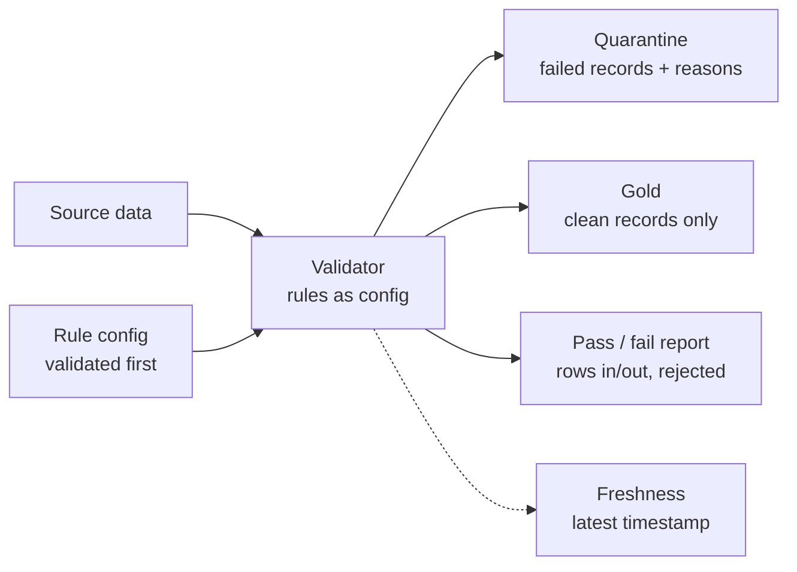

# Data Quality Validation Framework

A small, rule-driven framework: rules are config, not code. A validator loads a dataset, runs every rule, quarantines the records that fail, and writes a pass/fail report plus the clean records. Freshness is checked against the latest timestamp, the same way a daily DQ check watches for no new data.

All data is synthetic, all code is original and clean-room, and no proprietary code, data, schema names, or internal system details from any employer are included. No company names, locations, or real personal data appear anywhere in this repo.

## The problem

Bad data that lands unnoticed poisons every dashboard and model downstream. Checks need to run before data lands in gold, not after someone spots a wrong number.

## What it does

- **Schema check:** required columns present, and per-column types (`int`, `float`, `str`, `datetime`) validated on every non-empty value.
- **Row rules:** not-null, uniqueness, range, allowed-values, and referential checks (a column must match a master list, inline or from a CSV file).
- **Quarantine:** failed records are written to quarantine with every reason attached, never to gold. A record failing several rules appears once, with all its reasons; duplicate ids quarantine every row carrying the id, but each row lists only the rules it itself failed.
- **Clean output:** the rows that passed every rule, the only rows allowed into gold.
- **Freshness:** the latest timestamp is parsed as a real datetime (not compared as a string) and checked against an expected date or a maximum age. Malformed timestamps are counted and reported, not fatal.
- **Report:** one JSON report with rows in / rows out / rejected counts, per-rule pass/fail counts, and the quarantined ids.
- **Config validation:** the YAML rule file is validated before any row is read, so a typo (unknown key, `low > high`, a rule on a column that does not exist, a missing reference file) fails fast with the key named.

## Architecture — Before / After

### Before

Bad data landed unnoticed. Checks were manual, run after the load, with no quarantine, no alert, and no record of what failed. A bad load could sit in gold until a business user found it.

### After

Data is validated on arrival. Records that fail are quarantined, the failure is logged, and only clean records move on to gold.



<details>
<summary><b>Validation rule flow — click to expand</b></summary>

<br>

1. **Load config:** read and validate the YAML rule file; fail fast on any invalid section.
2. **Load data:** read the dataset CSV (missing file, empty file, duplicate header, or ragged row is an error, not a crash).
3. **Schema check:** required columns present, types match, otherwise fail the whole batch.
4. **Row rules:** not-null, uniqueness, range, allowed-values, and referential checks, collecting every failure with its record id, rule name, and row position. Empty values belong to `not_null` only, so one bad cell produces one failure, not one per rule.
5. **Freshness check:** parse the latest timestamp and compare it with the expected date (or maximum age); if no new data, fail freshness.
6. **Quarantine:** failed records are written to quarantine, never to gold, with every reason attached.
7. **Report:** write the JSON report with rows in, rows out, rejected counts, and per-rule results; exit non-zero when validation fails.

</details>

| Earlier issues | Risk | Impact after |
|---|---|---|
| Bad data landed unnoticed, checks were manual and after the load | Wrong numbers reached dashboards and models before anyone noticed | Bad data is caught on arrival, before it reaches gold |
| No quarantine, failed records mixed with clean ones | A bad load could corrupt a whole gold table | Failed records are quarantined, clean records still flow |
| No freshness check, stale data looked current | Stale data was reported as if it were fresh | Freshness is checked on the latest timestamp, with an alert if no new data arrives |
| No record of what failed | The same bad load could repeat with no trace | Every failure is logged with its rule and record id |

## Setup

```bash
python3 -m venv .venv
.venv/bin/pip install -e ".[dev]"
```

This installs the `dq-validate` and `dq-generate` commands and pytest. The only runtime dependency is `pyyaml` (see `requirements.txt`); `requirements-dev.txt` adds pytest.

## Run

```bash
.venv/bin/dq-generate
.venv/bin/dq-validate
.venv/bin/dq-validate --dataset data/records.csv --rules rules/orders.yaml --output-dir data
```

Without installing, from the repository root:

```bash
PYTHONPATH=src python3 -m src.dq.cli generate
PYTHONPATH=src python3 -m src.dq.cli validate --dataset data/records.csv --rules rules/orders.yaml
```

The legacy entry points `python -m src.generate_data` and `python -m src.run_validation` still work and delegate to the same code.

### Exit codes

- `0` — validation passed (every rule and freshness passed).
- `1` — validation ran but failed (a rule or freshness failed). The example dataset exits `1` on purpose: it contains 3 intentional bad rows.
- `2` — error (missing dataset, malformed or invalid config, bad arguments).

### Example output

`dq-generate` writes 103 synthetic records (100 clean, 3 bad to exercise quarantine) and a 100-row customer master list. `dq-validate` then logs one line per rule plus the row counts (to stderr) and prints the JSON report (to stdout):

```
rows in=103 rows out=100 rejected=3 report=data/report.json
```

```json
{
  "rows_in": 103,
  "rows_out": 100,
  "quarantined_rows": 3,
  "quarantined_ids": ["101", "102"],
  "passed": false,
  "freshness": {
    "passed": true,
    "latest": "2026-11-22T10:00:00+00:00",
    "detail": "latest 2026-11-22T10:00:00+00:00",
    "invalid_timestamps": 0
  }
}
```

(The full report in `data/report.json` also has a `rules` array with every rule's pass/fail counts and each failure's record id, rule, detail, and row position.) The log lines for the same run are:

```
schema: PASS (4 passed, 0 failed)
schema:type:id: PASS (103 passed, 0 failed)
schema:type:customer_id: PASS (102 passed, 0 failed)
schema:type:amount: PASS (103 passed, 0 failed)
schema:type:updated_at: PASS (103 passed, 0 failed)
not_null:customer_id: FAIL (102 passed, 1 failed)
not_null:amount: PASS (103 passed, 0 failed)
unique:id: FAIL (102 passed, 1 failed)
range:amount[0,10000]: FAIL (102 passed, 1 failed)
reference:customer_id: FAIL (100 passed, 2 failed)
freshness: PASS (latest 2026-11-22T10:00:00+00:00)
rows in=103 rows out=100 rejected=3 report=data/report.json
```

3 bad rows but only 2 quarantined ids: the duplicate id `102` appears on two rows, and both are quarantined. Outputs are `data/quarantine.csv` (3 rows, each with its reasons), `data/clean.csv` (100 rows), and `data/report.json`.

Re-running either command on the same input produces byte-identical outputs: both writers are deterministic overwrites, not appends, so a re-run replaces the old quarantine instead of double-counting it.

## Test

```bash
.venv/bin/python -m pytest tests/ -q
```

72 tests, one file per module, covering config validation, every rule check, freshness, quarantine, CSV I/O, the validator and report, the generator, and the CLI end to end (including exit codes). Tests are `unittest.TestCase` style, so they also run without pytest:

```bash
python -m unittest discover -s tests
```

## Rule config

`rules/orders.yaml` (see `src/dq/config.py` for the full schema):

```yaml
required_columns: [id, customer_id, amount, updated_at]
column_types: {id: int, customer_id: str, amount: float, updated_at: datetime}
not_null: [customer_id, amount]
unique: [id]
range: {amount: [0, 10000]}
reference:
  customer_id:
    file: data/customers.csv   # resolved against the config's directory, then the working directory
    column: customer_id
expected_date: "2026-11-22"    # or max_age_hours: 48
```

Every column a rule names must be listed in `required_columns`. Unknown keys, bad ranges, bad dates, and missing reference files are all rejected at load time.

## Synthetic data

`dq-generate` (see `src/dq/generator.py`) builds an orders-like dataset with a fixed seed and a fixed reference date of 2026-11-22, so the same command always produces the same files. The 3 bad rows are intentional:

- id 101: blank `customer_id` (not-null failure).
- id 102, amount 99999: out of range, and customer `C0102` is not in the master list (range + reference failures).
- id 102 again, amount 20: a duplicate `id` (unique failure), also with the unknown customer.

No real data, no real customer ids, no invented performance numbers: the only numbers in this repo are the counts a run actually produces.

## Files

- `src/dq/config.py` — rule config schema, loading, and validation (`RuleConfig`)
- `src/dq/rules.py` — row-level checks (`check_schema`, `check_not_null`, `check_unique`, `check_range`, `check_allowed_values`, `check_reference`, per-column type checks)
- `src/dq/validator.py` — orchestration: runs every rule, builds the `ValidationReport`
- `src/dq/freshness.py` — timestamp parsing and freshness checks
- `src/dq/quarantine.py` — quarantine writer (reasons per row) and clean writer
- `src/dq/report.py` — `ValidationReport`: rows in/out, rejected counts, JSON output
- `src/dq/io.py` — CSV load/write with input validation
- `src/dq/generator.py` — deterministic synthetic data generator
- `src/dq/cli.py` — `dq-validate` / `dq-generate` commands, logging, exit codes
- `src/dq/errors.py` — `DataQualityError`, `ConfigError`, `InputError`
- `src/dq/constants.py` — named constants (paths, limits, supported types)
- `src/dq/logging_config.py` — logging setup (diagnostics to stderr)
- `src/run_validation.py`, `src/generate_data.py` — legacy entry points (thin shims)
- `rules/orders.yaml` — example rule config
- `tests/` — 72 tests, one file per module

## Deliberately left simple

- **No network or API calls anywhere**, so there is no retry/backoff logic: the only inputs are local files, and a failure there is reported as an error (exit 2), not retried.
- **CSV in, CSV out.** No database, warehouse, or streaming sink; the framework validates one batch at a time and the clean/quarantine split is the handoff.
- **Failure details are capped at 100 per rule** (the `failed` counter is never capped), so a pathological input cannot grow the report without bound.
- **No alerting integration.** Freshness failures are reported in the log and the JSON report; wiring that to an on-call channel is deployment-specific and out of scope for this repo.
